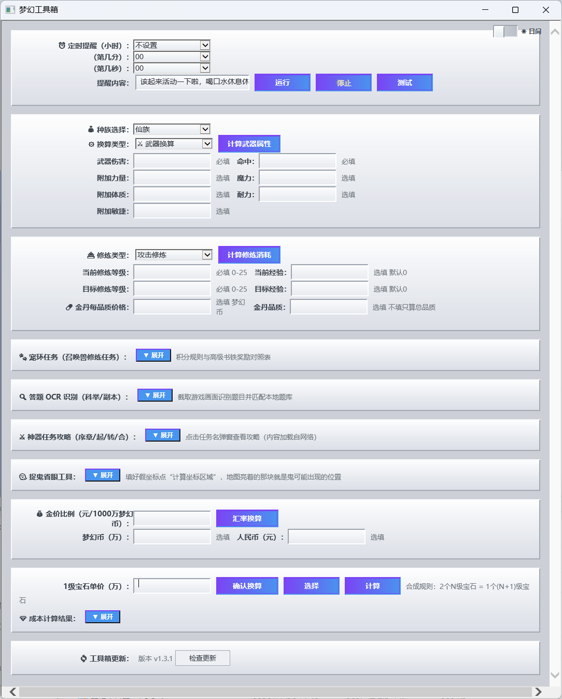

# 梦幻畅玩服简易工具箱

个人自用的《梦幻西游》畅玩服辅助工具箱。纯前端实现，无需安装、无需联网即可使用核心功能（地图底图与攻略内容除外）。

提供两种形态，功能与视觉保持一致：

| 版本 | 文件 | 运行方式 | 适用场景 |
|---|---|---|---|
| 电脑版 | `app\梦幻工具箱.hta` | 双击 `启动工具箱.bat`（或直接双击 `.hta`），由 Windows 自带 mshta 运行 | 主力使用，独享 OCR 能力 |
| 电脑版 exe | `dist\梦幻工具箱_v<版本>.exe` | 双击 exe，首次运行自动解包到同目录的 `MengHuanToolbox\` 再启动 | 只想下载一个文件 |
| 移动版 | `app\梦幻工具箱移动版.html` | 任意现代浏览器打开 | 手机上查表、算价、看地图 |



---

## 功能一览

| 模块 | 说明 |
|---|---|
| ⏰ 定时提醒 | 支持「每天 HH:MM:SS」与「每小时第 MM 分 SS 秒」两种模式，文案可自定义，可先点测试预览 |
| ⚔️ 武器 / 装备换算 | 选种族 + 输入伤害命中（或防御）+ 附加五维，得出伤害/法伤/防御/气血/速度，支持最多 30 条历史对比 |
| 🏯 修炼消耗计算 | 攻击/法术/防御/抗法/猎术/召唤兽六类修炼，按当前→目标等级与经验折算修炼次数、正常/免资材花费、九转金丹与修炼果、帮派贡献要求 |
| 🐾 宠环任务 | 13 类任务积分登记、1~5 号独立计数、成本累计、按日历查历史、导出导入、积分奖励对照表 |
| 🔍 答题 OCR 识别 | 截取游戏画面识别题干，匹配本地题库给出答案（电脑版专属） |
| ⚔️ 神器任务攻略 | 序章 / 起 / 转 / 合 任务列表，点击弹窗加载网络攻略 |
| 🗺️ 捉鬼省眼 | 选场景 + 填假坐标，地图上压暗只留出鬼可能出现的范围；含找鬼规律速查表 |
| 🎯 坐标实时监控 | 自动 OCR 读取游戏窗口左上角的 `X:196 Y:64`，超出搜索范围时在游戏窗口顶部贴横幅，左侧大箭头指明该往哪走；点一次会先自动读右侧任务栏里的捉鬼 / 鬼王任务、选好场景并回填假坐标（红字与色弱模式的黄字都认，两种任务都在时先弹框让你选，电脑版专属） |
| 💰 金价换算 | 元/千万梦幻币 ↔ 万梦幻币 双向换算 |
| 💎 宝石成本 | 按 2 个 N 级合成 1 个 N+1 级，勾选目标等级算合计成本 |
| 🔄 在线更新 | 界面底部显示当前版本，点「检查更新」比对百度网盘分享目录里的版本（读不到退回 GitHub）：远程更新才下载整包替换程序文件（`app\data` 保留），一致或更老不下载 |
| 🎨 主题 / 窗口 | 日间 / 夜间切换，窗口尺寸与位置自动记忆 |

---

## 快速开始

### 电脑版

1. **单文件 exe（最省事）**：把 `dist\梦幻工具箱_v<版本>.exe` 放到桌面等**可写**目录双击。首次运行会在它旁边建一个 `MengHuanToolbox\` 并解包启动，以后双击即秒开；换成新版本的 exe 时，旧的 `app\data\`（锁定角色、框选区域、宠环历史）会保留。
2. **文件夹版**：下载整个项目（GitHub 页面 **Code → Download ZIP**，或用打包脚本产出的 `dist\梦幻工具箱_v<版本>\` 目录 / 同名 zip），**解压到任意目录**。工具本体在 `app\` 里——`.hta`、`ocr\`、`ocr_tiku.txt` 三者必须保持同级，不要只把 `.hta` 单独拷出来。双击根目录的 `启动工具箱.bat`：它会自动清掉「来自 Internet」的锁定（否则 Windows 会拦 `.hta` 和脚本）、粗检 `app\ocr\` 与题库是否在位，再拉起 `app\` 里的工具箱；只想检查不想启动时用 `启动工具箱.bat --check`。exe 被拦时就用这一条，内容完全一样。
3. 工具箱启动时会在后台跑一次**环境自检**（约 1~2 秒，结论写在答题区状态行）。缺文件、缺中文 OCR 语言包、PowerShell 版本过低会用中文弹一次说明；同一组问题只提示一次，修好后再开自动恢复正常。随时想重查：点答题区状态行里的「环境检查通过 / 环境有问题」文字。
4. 涉及 OCR 的模块会在需要时自动调起 `powershell.exe`，其余计算类功能完全不依赖它。
5. **保持最新**：界面最下方「🔄 工具箱更新」那一行显示当前版本（只读本地 `CHANGELOG.md`，不联网），点「检查更新」才会去比对远程版本；有新版本会问你要不要下载替换，一致或更老则什么也不动。细节见下文「在线更新」。

**OCR 功能的前提条件**

- Windows 10 / 11（依赖系统自带的 `Windows.Media.Ocr` 引擎）
- 系统已安装**中文 OCR 语言包**（简体中文系统默认就有；可在「设置 → 时间和语言 → 语言」中确认）
- 不要移动或重命名 `app\ocr\` 目录及其中的脚本

### 移动版

1. 用浏览器打开 `app\梦幻工具箱移动版.html`（可直接双击，也可放到手机里用浏览器打开）。
2. 题库与宠环历史保存在浏览器的 `localStorage`，换设备或清缓存会丢失，请用「导出」按钮备份。

**两端数据互通**

- 题库：电脑版读写 `app\ocr_tiku.txt`（每行 `题目|答案`）；移动版在「题库管理」里可「选文件导入」该文件，也可「导出 ocr_tiku.txt」拿回电脑用。
- 宠环历史：电脑版存 `app\data\pet_cost_history.txt`；移动版可导出/导入同一份文本。

---

## 目录结构

```
Gadget/
├─ 启动工具箱.bat         ★ 入口：双击它（解除下载锁定 + 粗检文件 + 拉起工具箱，--check 只检查）
├─ 打包发布.bat           双击打包发布：一次产出目录 + zip + exe，名字只带版本号（开发用）
├─ README.md
├─ CHANGELOG.md            更新说明：既是版本号唯一来源（最新一节），也随发布包发出
├─ docs/preview.png        README 顶部的界面预览图（随 README 一起发出）
├─ app/                    运行件（整个目录必须完整，不能只拷单个文件）
│  ├─ 梦幻工具箱.hta        电脑版主程序（HTML + VBScript + JScript）
│  ├─ 梦幻工具箱移动版.html 移动版主程序（单文件 HTML + JS）
│  ├─ ocr_tiku.txt         答题题库，每行「题目|答案」，# 开头为注释
│  ├─ ocr/                 识别脚本与文案
│  │  ├─ ocr_answer.ps1    答题识别：截屏 + OCR + 题库匹配
│  │  ├─ ocr_region.ps1    框选识别区域工具
│  │  ├─ ghost_monitor.ps1 捉鬼坐标实时监控：截屏 + OCR + 游戏窗口浮层
│  │  ├─ ghost_texts.txt   浮层提示文案（UTF-8）
│  │  ├─ env_check.ps1     环境自检：文件清单 / OCR 语言包 / PowerShell 版本
│  │  ├─ update_toolbox.ps1 在线更新：比对远程版本 + 下载整包替换（保留 data）
│  │  └─ remind_notify.ps1 定时提醒的气泡（固定脚本，不再用内联 -Command）
│  └─ data/                运行时生成（已 gitignore，删掉会自动重建）
│     ├─ ghost_config.txt  锁定的角色 ID + 微调后的读取区域
│     ├─ ocr_config.txt    答题框选区域
│     ├─ env_warn.txt      上一次已提示过的问题（修好后自动删除）
│     ├─ env_ok.txt        上次自检通过的日期（7 天内不重复自检）
│     ├─ ocr_tiku.prev.txt 更新前备份的题库（没有更新过就没有这个文件）
│     ├─ update_source.txt 可选：自定义更新源（share= / pwd= / folder= / version= / package=）
│     └─ pet_cost_history.txt 宠环成本历史
├─ tools/                  开发用脚本（玩家不需要，可整目录删掉）
│  ├─ make-release.ps1     打发布包：dist\<名称>_v<版本>\ + 同名 .zip（白名单，同版本替换）
│  ├─ make-exe.ps1         打单文件 exe：把上面刚产出的发布目录内嵌进 C# 启动器（根目录 打包发布.bat 双击调它）
│  ├─ shot-preview.ps1     打包前自动重截 README 的界面预览图（docs\preview.png）
│  ├─ sync-cloud.ps1       发布准备：把这一版收进 dist\_cloud，并拉起百度网盘客户端（最后拖一下）
│  ├─ launcher-texts.txt   exe 启动器的中文提示文案（UTF-8，C# 源码保持纯 ASCII）
│  ├─ cap_quest.ps1        把游戏客户区原样截成 PNG（离线验证任务 OCR）
│  └─ crop_strip.ps1       裁出读取器实际查看的那一块，排查裁偏
└─ dist/                   打包产物（已 gitignore）：<名称>_v<版本>\ 与同名 .zip + .exe（同版本重打会替换）；_cloud\ 是待传到网盘的目录
```

`app\` 是运行必需的（`.hta` 通过自身所在目录找 `ocr\` 与题库）；`tools\`、`dist\`、`app\data\` 都可按需删除——`data\` 里的东西删掉后会在首次保存时重建。

---

## OCR 模块使用要点

### 答题识别（科举 / 副本）

- **识别游戏画面**：截一次当前游戏窗口，识别题干并匹配题库。
- **实时识别**：开一次后持续监听，换题自动重新识别；用完点停止。
- **框选识别区域**：只在题目区域识别，准确率最高，也更快。选错位置随时重新框选。
- **整窗识别**：默认模式，无需配置，适合不想框选时使用。
- 题库匹配做了容错：缺字、错字、多字都能模糊命中，也支持拼音首字母或全拼（如 `zxd`）。
- 题库未命中时可直接「网页搜索」题干。

### 坐标实时监控（捉鬼）

1. 接到捉鬼任务后，直接在捉鬼面板点「▶ 坐标实时监控」。
2. 程序会先 OCR 游戏窗口**右侧任务追踪栏**里的捉鬼 / 鬼王任务，认出场景和假坐标就自动选好地图、填好坐标并算好搜索范围（状态行显示「已按捉鬼任务填入 长寿村 88,177」），然后开始监控。两个任务同时挂在栏里时会先弹框，把两边的地点与坐标都列出来，点「是 / 否」选一个（点「取消」不启动监控）。
3. 读不到任务时（任务彩字模糊或没接任务）退回手动流程：已有搜索范围就按原范围监控，没有就提示先填假坐标。
4. 监控期间**不需要框选任何区域** —— 默认自动读取游戏窗口**左上角**的 `X:xxx Y:xxx`。角色还没进入搜索范围时，游戏窗口顶部会出现红色横幅：**左边一个白色箭头指向该走的方向**（八个方向都有，如 ↖ 往左上走），右边显示当前坐标和还差几格；进入范围后横幅转绿并提示找哪个角，这时不再画箭头。
5. 用完点「■ 停止监控」。

说明：

- 自动读任务取的是游戏客户端右侧的任务追踪面板（约窗口宽度的 82%~100%、高度的 9%~60% 那一块）；面板挪到别处或 UI 缩放变化过大时可能读不到。
- 任务描述那一行是彩字（平时红字，游戏开色弱模式后变黄字），具体识别规则见下方「任务栏识别规则」；彩字在复杂背景下仍不如白字稳，读出来数字有偏差时手动改一下再点「计算坐标区域」即可。
- 游戏窗口最小化时无法截屏，横幅会提示最小化；切回游戏自动恢复。
- 焦点切回工具箱时自动暂停截屏，切回游戏自动继续。
- 只有改了 UI 缩放 / 分辨率后识别不准，才需要点「微调坐标区域」手动圈一次；在该对话框选「否」即可恢复自动模式。

#### 任务栏识别规则（含色弱模式）

- **颜色**：场景名和假坐标平时印成红字；游戏开启**色弱（色盲友好）模式**后，游戏自己会把这一行改成黄字 / 琥珀字。程序不依赖某一种固定色值，两种颜色走同一套规则，**不需要为了识别去关色弱模式**。
- **三遍读取**：亮度 ×2.0、亮度 ×3.0，再加一遍「彩度通道」×4.0。彩度通道里红字和黄字都会变成亮字，灰底、绿色标题、背景草地都变暗；白字（任务名、「附近抓」）保留成暗白，保证锚点（捉鬼 / 抓鬼 / 钟馗）和「场景名 + 坐标」出现在同一遍里。
- **投票**：三遍各自解析，先按场景名投票，再按坐标对投票，平票取先读到的那次；被截断的读数（`1,142` 是 `100,142` 的截断）不计票。
- **两种任务**：锚点决定类型——`捉鬼` / `抓鬼` / `钟馗` 算捉鬼，`鬼王` / `地藏王` 算鬼王（前者先判，所以「抓鬼王」不会被误当捉鬼）。两类**分别投票**，不会把两个任务的坐标混在一起；只有一类读到时直接用，两类都读到时弹框让你选，选完才填坐标、算范围、启动监控。
- **局限**：彩字始终不如白字稳，同一行里的数字偶尔会被 OCR 读丢一位；这时手动改一下数字再点「计算坐标区域」即可，不影响监控本身的其余功能。

---

## 在线更新

界面最下方多一行「🔄 工具箱更新：版本 v1.3.1 ｜ 检查更新」：左边是本地版本，点按钮才会去比对远程版本。

1. **先比对，再决定下不下**。远程版本默认看百度网盘分享目录 `MengHuanToolbox` 里的文件名（`梦幻工具箱_v<版本>.zip` / `.exe`，取其中最高的版本号），与本地 `CHANGELOG.md` 逐段数字比较；分享目录读不到（离线、目录还空着、提取码变了）时自动退回 `https://raw.githubusercontent.com/nhy920930/Gadget/master/CHANGELOG.md` 的第一条 `## x.y.z`。远程更新 → 弹框问你要不要下载；版本一致 →「已是最新版本」；本地更新（比如你自己改过一份）→「本地比远程新，不更新」。**一致或更老都不下载**，连点几次也不会重复下载。
2. **为什么比对和下载不是一个地方**：百度网盘不给未登录的客户端下载链接（接口直接回「违规操作，无法下载」），所以「比对版本」用网盘、「拿整包」仍走 GitHub 公开仓库（`codeload` 的 master 压缩包）。两边版本对不上时宁可不动：网盘已经发了新版本、GitHub 还停在旧包，会提示「云盘已有 vX，但自动下载源还是旧包」并可以直接点开分享页手动下载，不会把本地换回旧版。
3. **替换哪些文件**：`.hta`、`梦幻工具箱移动版.html`、`app\ocr\*.ps1`、`app\ocr\ghost_texts.txt`、`app\ocr_tiku.txt`、根目录的 `*.md` 与 `启动工具箱.bat`（打包按钮 `打包发布.bat` 带着 `gadget-devtool` 标记，会被跳过）、`docs\`、`tools\`。
4. **本机数据不动**：`app\data\` 整目录不碰——锁定角色、框选区域、7 天自检标记、宠环历史都照旧。
5. **题库会被新版取代**（不取代的话新版题目永远到不了），替换前自动备份成 `app\data\ocr_tiku.prev.txt`；自己手动加过词条想找回，就从这份备份里复制。
6. **正在识别 / 监控时点更新**：会先自动停掉实时识别与坐标监控再替换；万一还有文件被别的程序占着，结束时会把没能替换的文件列出来，关掉工具箱重开、再点一次「检查更新」就能补齐。
7. **更新完要重开**：文件已经落盘，当前窗口跑的还是旧代码，关掉工具箱重新打开即生效（exe 版重新双击 exe）。
8. **exe 版同理**：更新落在它旁边的 `MengHuanToolbox\` 里，`.version` 标记保持不变，所以下一次启动不会被 exe 自带的旧版本回滚；想彻底换成新版 exe 再手动下载一次就行（`app\data\` 仍会保留）。
9. **换分享或换源**：整条渠道可以搬走，新建 `app\data\update_source.txt`，按需写几行（http/https 地址或本地路径都行）：

   ```ini
   # 换一个百度网盘分享：链接或路径都行，提取码单独一行
   share=https://pan.baidu.com/s/1xxxxxxxxxxxxxxxxxxxxx?pwd=abcd
   pwd=abcd
   folder=MengHuanToolbox

   # 或者完全绕开网盘，直接用别处的版本记录 + 整包
   version=https://你的镜像/CHANGELOG.md
   package=https://你的镜像/最新的整包.zip
   ```

   `package` 要指向**包含 `app\` 的整包 zip**（GitHub 的 `Code → Download ZIP` 那一种，外面多套一层目录也能识别）；写了 `version=` 就不再读网盘。
10. **移动版没有这个按钮**：浏览器打开的单文件 HTML 拿不到本地脚本和文件，升级仍需重新下载；版本号同样看 `CHANGELOG.md` 最新一节。

失败时状态行会写原因（超时 / 404 / 解压失败等），弹框里也会说明，并问你要不要直接打开网盘分享页手动下载；最常见的是网络不通（百度网盘与 GitHub 两边都要能访问）或被安全软件拦了 PowerShell（见下一节）。

---

## 被安全软件拦住怎么办

工具箱的识别、捉鬼监控、环境自检、定时提醒都要调用 **Windows PowerShell** 去跑 `app\ocr\*.ps1`。这些脚本没有数字签名，调用方式又是「隐藏窗口 + 启动后台进程」，正好落在杀毒软件和 EDR 的行为规则里，所以会在个别机器上被弹窗拦截或静默终止——**报错本身不是工具箱有 bug，是调用被外部截断了**。

### 1.2.2 已经做了哪些降噪

- **调用方式统一**：所有 PowerShell 调用走全路径 `%SystemRoot%\System32\WindowsPowerShell\v1.0\powershell.exe`，参数固定为 `-NoProfile -NonInteractive -ExecutionPolicy Bypass -WindowStyle Hidden -File <脚本>`，不再出现「无路径 powershell」和缺参数的写法。
- **去掉内联脚本**：定时提醒原来用 `-Command` 内联一长串 `Add-Type` 弹气泡，已改为固定脚本 `app\ocr\remind_notify.ps1`。命令行从「一大段脚本」变成「一个脚本路径」，规则匹配面小得多。
- **减少进程次数**：环境自检改成 7 天缓存（`app\data\env_ok.txt` 记日期）。通过一次后，之后一周内开机不再起 PowerShell；需要重查时点答题区那一行状态。
- **启动器只解一次锁定**：`启动工具箱.bat` 不再每次启动都递归扫全目录跑 `Unblock-File`，改成首次运行做一次。
- **exe 补了文件属性**：`MengHuan Toolbox` 的标题 / 产品 / 版本信息写进程序集，属性里不再是「0.0.0.0 / 无描述」。

### 怎么放行

按机器上实际在跑的安全软件选一条（一台机器可能同时装多个）：

| 安全软件 | 放行入口 |
| --- | --- |
| 腾讯电脑管家 | 病毒查杀 → 信任区 → 添加文件夹 |
| 奇安信天擎（企业版） | 个人端改不了策略，需要公司 IT 在控制台下白名单；联系 IT 时说明「内部自用工具，需运行本地 PowerShell 脚本」 |
| Windows Defender | 病毒和威胁防护 → 管理设置 → 排除项 → 添加文件夹 |
| 360 安全卫士 | 木马查杀 → 信任区 → 添加目录 |

放行的是**整个工具箱目录**（单文件 exe 是解包出来的 `MengHuanToolbox\` 目录），不要只放行 `.hta` 或 `.exe`：真正被拦的是目录里的 `app\ocr\*.ps1`。

### 判断到底是哪一环被拦

1. 点答题区状态行（「环境检查通过」/「环境检查超时…」）强制重查一次，看是否还是超时。
2. 打开命令行，手动跑一次自检：

   ```bat
   powershell -NoProfile -ExecutionPolicy Bypass -File app\ocr\env_check.ps1
   ```

   - 手动能打印出 `META` 一大串、工具箱却超时 → 拦的是工具箱发起的隐藏调用，去上面表格里放行目录；
   - 手动也报「无法加载文件，因为在此系统上禁止运行脚本」或直接被安全软件终止 → 拦的是 PowerShell 本身（组策略执行策略 / 安全软件脚本防护），同样按上表处理。

3. 放行后**不需要重装**，直接点状态行重查即可（会作废 7 天缓存强制跑一遍）。

### 看到这些提示基本就是被拦了

- 「环境检查超时（点这里重查…）」
- 「识别超时：…反复超时多半是安全软件拦截了 PowerShell 脚本」
- 「实时识别已中断（后台识别脚本无响应）」
- 「监控已中断（后台脚本无响应）」
- 「框选已超时结束（若每次都这样…）」
- 「检查超时：…」/「更新超时：…」

这些都是「启动成功但没拿到结果」的形状：进程被拦下后不会写结果文件，轮询超时后落到这些文案。计算类功能（属性换算、修炼消耗、宠环记录）不依赖 PowerShell，不受影响。

**如果弹窗是「发现可疑的无文件攻击行为」且被拦的是 `%TEMP%` 下的 `.vbs` / `cscript.exe`，那不是工具箱。** 工具箱运行只用 `mshta` 打开界面、用 PowerShell 跑 `app\ocr\*.ps1`，从不调用 `cscript`，也不往临时目录写脚本（详见「开发说明 → 自带校验」）。这类弹窗来自外部脚本或开发期的一次性校验，点「允许」并勾「不再提醒」即可；如果反复出现，把拦截路径发我看一下。

---

## 常见问题

**双击 `.hta` 后界面错乱或按钮点了没反应**
本程序面向 IE 内核（quirks 模式）编写，请用双击方式启动（由 mshta 打开）。用浏览器打开 `.hta` 会因浏览器安全策略拒绝执行脚本。

**双击 `启动工具箱.bat` 只闪一下黑框，工具箱没出来**
黑框是启动器的正常动作（检查完就直接拉起工具箱并自动关闭）。没起来时依次确认：① 解压是否完整——`启动工具箱.bat` 在根目录，`app\` 里要有 `.hta` 与 `ocr\`、`ocr_tiku.txt`；② 在文件管理器的地址栏里执行 `启动工具箱.bat --check`，看它报的是缺文件还是找不到 PowerShell；③ 安全软件是否拦了 `mshta.exe`。

**下载后被 Windows 拦住 / 提示「无法验证发布者」**
网页下载的文件带「来自 Internet」标记，Windows 会对 `.hta` 和脚本弹安全提示。启动器第一次运行时用 `Unblock-File` 清一遍并留下 `app\data\.unblocked` 标记，之后不再重复（每次启动都跑一遍隐藏 PowerShell，本身容易被安全软件盯上）。如果换了一份新压缩包覆盖到旧目录后又出现这个提示，删掉 `app\data\.unblocked` 再启动一次即可；如果整个 ZIP 就被安全软件隔离了，右键 ZIP →「属性」→ 勾「解除锁定」→ 再解压。

**exe 双击后弹「已保护你的电脑 / 无法验证发布者」**
exe 没有代码签名，Windows 会对从网络下来的 exe 弹这个提示：点「更多信息」→「仍要运行」。不放心就别运行它，改用同版本的 zip——里面是同一批文件，功能没有区别。安全软件直接把 exe 隔离时同理：解压 zip 后双击「启动工具箱.bat」即可。exe 解包出来的文件**不带**下载标记，所以不会有 `.hta` 被拦的问题。

**点「检查更新」提示失败 / 超时**
先看弹框里的原因：只读不到网盘时会自动退回 GitHub，两边都读不到才会失败——确认浏览器能打开百度网盘分享页和 GitHub 仓库主页；能打开但仍然超时，多半是安全软件拦了这次隐藏的 PowerShell（见「被安全软件拦住怎么办」）。下载到一半断网也不会留下半个文件：包先下到 `app\data\update_tmp\`，解压、校验通过才开始替换，失败会自动清掉这个临时目录，本机文件一个都没动。

**OCR 一直提示「没识别到坐标 / 没识别到题目」**
依次检查：① `app\ocr\` 目录是否完整；② 系统是否装了中文 OCR 语言包；③ 游戏窗口是否在前台可见；④ 识别区域是否偏移（重新框选 / 微调）。

**点监控后提示「没读到捉鬼或鬼王任务」**
先确认游戏里确实接了任务、右侧任务追踪面板是展开的，也可以先在游戏里切一次任务再点。自动读任务依赖任务栏里出现 `捉鬼` / `抓鬼` / `钟馗` 或 `鬼王` / `地藏王` 字样和一行「场景名 + 坐标」，别的任务（神器、宝图等）不会被当成捉鬼。仍然读不到时直接手动填假坐标并点「计算坐标区域」，监控本身不依赖自动读任务。

**鬼王任务也能读吗，两个任务都在会怎样**
都能读。两类任务格式一样，程序按锚点分行分类，各投各的票；两个任务同时挂在任务栏里时，会弹框把两边的场景和假坐标都列出来，点「是 / 否」选这条要追的（状态行会写明「已按捉鬼任务填入…」或「已按鬼王任务填入…」）。点「取消」则不启动监控，可以自己填坐标。

**游戏开了色弱（色盲友好）模式，任务描述的红字变成黄字了，还能读吗**
能，也不需要关掉色弱模式。读任务时分三遍识别（两遍亮度 + 一遍彩度通道），彩度通道里红色度和黄色度同时生效，所以红字、黄字都能读成白底亮字；白色锚点行也保留在同一遍里参与匹配。规则细节见上文「任务栏识别规则」，读到但数字有偏差时手动改一下即可。

**实时监控显示的坐标和游戏左上角对不上**
程序读的是左上角 `X:xxx Y:xxx`。旧版在 OCR 把 `X:11`、`Y:90` 拆到两行（中间还夹杂字）时，会把游戏时钟 `18:08:43` 当成坐标，提示成 `8,8` 之类；该问题已修正——现在按 X / Y 各自取值，并且只要画面里出现 `X:` / `Y:` 标记就绝不退回到「随便找一对数字」。若仍不一致，多半是数字本身被 OCR 读丢一位：点「停止监控」再点一次重试，或留一张截图。

**多开时监控读到了别的号 / 别的窗口的坐标**
捉鬼面板里的「游戏窗口」下拉就是干这个的：展开面板会自动列出当前开着的客户端（标着 `角色名[ID] · 窗口尺寸`），选中要盯的那个号即锁定（选项立即生效，正在监控会按新窗口重启）。锁定后只认这个号的窗口，切到别的**标签页**（那个号不显示了）会显示「没找到锁定的角色窗口」并暂停；切到别的**窗口**（被压住、不在前台）不用切回来，因为读的是窗口自己的画面，见下一条。选择会记在 `app\data\ghost_config.txt` 的 `pin=` 里，下次开工具箱还是同一个号；游戏重开后锁定的号不在列表里时会保留一项「（未在运行）」，点「刷新窗口」重选即可。一个客户端开多个标签页（如 饺子 / 神丶荼 两个标签）时，先把要锁的号切到前面，列表里才会出现它。不选（默认「自动」）就是旧的选择逻辑：取面积最大的游戏窗口。

**游戏窗口被别的窗口压住了，还能识别吗**
能。读坐标时优先取**这个窗口自己的画面**（`PrintWindow` + `PW_RENDERFULLCONTENT`，取 DWM 合成的窗口表面），不再是屏幕像素，所以被聊天窗口、浏览器或另一个客户端压住照样能读——状态行会带上「· 窗口被遮挡也能读」。只有**最小化**时才会暂停（最小化的窗口没有可读表面），恢复窗口自动继续。取不到窗口画面时（刚开窗等）会退回抓屏幕，那种情况下才要求窗口在前台，相应会提示 `not_foreground` / `pin_hidden`——这也是为什么不建议长期依赖抓屏：抓屏只会读到压在上面那个窗口的画面。加 `-Capture screen` 可强制回到旧的抓屏方式（排查用）。

一个实测到的边界：**整个客户端被其它不透明窗口完全盖住**时，Windows 可能不再为该窗口合成新帧，此时读到的仍是这个窗口的像素（不会是别人的画面），但可能是最后一帧——坐标会停在旧值不跟着变。常见的多开平铺、聊天窗口/另一个客户端压住左上角都属于“局部遮挡”，实测仍在逐帧更新（盖住读坐标那块 4 秒后对比仍有 96 个采样点变化）；把窗口露出一点也会立即恢复。如果你宁可要“遮挡就暂停”也不想要可能停更的旧值，启动时加 `-Capture screen`。

**识别出的坐标是对的，但方向提示反了**
理论上不会发生。如果出现，多半是 OCR 把数字认错（例如把 `19` 读成「四」），此时程序会主动放弃本次结果并重试，而不会给出错误方向。持续出现请在「微调坐标区域」里手动限定区域。

**题库改了但电脑版没生效**
`app\ocr_tiku.txt` 必须保存为 **UTF-8** 编码，每行格式 `题目|答案`。编码不对会整行读不到。

**移动版题库是空的**
移动版不读本地文件（浏览器限制），需要在「题库管理」里粘贴文本保存，或点「选文件导入」选择 `app\ocr_tiku.txt`。

**宠环历史在哪**
电脑版在 `app\data\pet_cost_history.txt`；移动版在浏览器 localStorage。两端通过「导出 / 导入」互换。两端都是**改一次存一次**（点 + / - / 清零立刻写入，直接关窗也不会丢），「保存当天记录」平时不用点，只在存失败（例如文件被别的程序占用）时用来重试。

**地图底图显示不出来**
底图来自 `cdn.175lg.com` 在线加载。断网时会降级为灰框 + 象限红块，坐标范围与判断逻辑仍然可用。

---

## 开发说明

- **双端同步**：`梦幻工具箱.hta` 与 `梦幻工具箱移动版.html` 的功能与视觉须保持一致。电脑版独有的能力（OCR、窗口浮层）在移动版必须有等价的文字说明，不能让用户以为是 bug。
- **发布与入口**：项目根目录的 `打包发布.bat` 是**双击即打包**的入口（它是开发用文件，首行带 `gadget-devtool` 标记，白名单打包时会被跳过，不会混进发布包）；它只调 `tools\make-exe.ps1`，一次出齐目录 + zip + exe，结束后自动打开 `dist\`，并把这一版收进 `dist\_cloud`、拉起百度网盘客户端再打开那个文件夹（见下一条「发布到网盘」）。`tools\make-release.ps1` 用**白名单**打包，产出**只带版本号**的一对产物：`dist\<名称>_v<版本>\`（可直接双击启动器的独立目录）与同名 `.zip`——版本号已经能唯一标识一次发布，再叠时间戳只会把文件名拉长到影响使用。名字里没有时间戳，所以**同一版本重新打包会原地替换**那三件产物（先删同名目录 / zip / exe 再重建，否则 `dist\` 里会留下两份同版本、又无法分辨先后的包；exe 还在运行时脚本会提示先关掉）；**其它版本**不受影响，可以继续在 `dist\` 里并存。版本号不单独存文件：`CHANGELOG.md` **最新一节 `## <版本号>`** 就是当前版本，同一份文件也随包发出当更新说明，改一处就够（`-Version 1.1.0` 可临时覆盖，但会在没写说明时给出警告）。流程是先把选中文件按原相对路径复制到版本目录，再把这个目录压成 zip，两者内容始终一致。只装 `*.md`、`*.bat`、`docs\*.png`、`app\*.hta`、`app\*.html`、`app\ocr\*.ps1`、`app\ocr\ghost_texts.txt`、`app\ocr_tiku.txt`，`app\data\`（锁定角色 ID、框选区域、自检签名、宠环历史）与 `tools\`（开发脚本）整目录不进包，本机状态不可能被误打进去。入口是 `启动工具箱.bat`：先找 `app\*.hta`，找不到再回退到自身目录（兼容旧的平铺结构）；按通配找主程序（中文名被解压工具弄乱也照样能找到；多个 `.hta` 时取体积最大的那个）、首次运行时用 `Unblock-File` 清一遍下载标记（成功后在 `app\data\.unblocked` 留标记，之后不再重复跑隐藏 PowerShell）、粗检 `app\ocr\` 与题库，最后交给 `mshta`。`启动工具箱.bat` 与 `tools\*.ps1` **内容必须是纯 ASCII**——`cmd.exe` 按 OEM/ANSI 代码页解析批处理，中文字面量会乱码甚至打断解析（行尾符也必须是 CRLF）；中文提示一律放在 HTA（自检）与 README 里。
- **单文件 exe**：`tools\make-exe.ps1` 先调 `make-release.ps1`，再把刚产出的目录内嵌进一个 C# 小启动器（用 `%WINDIR%\Microsoft.NET\Framework64\v4.0.30319\csc.exe`，.NET Framework 4 自带，不需要装 SDK），产出同名的 `dist\<名称>_v<版本>.exe`，同版本重打会替换旧 exe（其它版本的 exe 不动）。exe 只是壳：首次运行在**自己所在目录**建 `MengHuanToolbox\`，解开内嵌内容后交给 `mshta`；`.version` 记录的是 `<版本>+<打包时间>`（例如 `1.2.2+20261126-143739`），一致就跳过解包；不一致——包括同版本重打出来的新包——就清空工作目录后重新解包，但**保留 `app\data\`**。文件名只带版本号，靠这个标记才分得清「同版本的另一份构建」，否则用户换了新 exe 也会因为版本号没变而继续跑旧的解包结果。加 `--extract` 只解包并打开目录。载荷是自己拼的容器（`[int32 清单长度][name|size 清单][原始字节]`，整体 gzip），因为启动器只引用 `System.dll` 与 `System.Windows.Forms.dll`，不依赖 `System.IO.Compression.FileSystem` 的 GAC 路径。中文文案在 `tools\launcher-texts.txt`（UTF-8，`|` 分段），C# 源码与脚本本身保持纯 ASCII。程序集带 `AssemblyTitle` / `AssemblyProduct` / `AssemblyVersion` 等文件属性（`make-exe.ps1` 里的 `__ASMVERSION__` 由版本号前三段补 `.0` 得出，格式不对时回退 `1.0.0.0`），属性页不再是「0.0.0.0 / 无描述」，也少一条「无信息二进制」的可疑特征。改完 HTA 记得重打 exe。
- **发布到网盘**：`tools\sync-cloud.ps1`（打包脚本末尾自动调，`-NoCloud` 跳过）把 `CHANGELOG.md` 和本次的 `<名称>_v<版本>.zip` / `.exe` 收进 `dist\_cloud`，并把里面**其它版本**的清掉——网盘目录里永远只该有一个版本，否则玩家拿错包就成了答疑问题。然后它找百度网盘客户端（先取正在运行的进程路径，再找常见安装位置与卸载登记），没开就拉起来，并打开 `dist\_cloud`。**最后把文件拖进「我的网盘 / MengHuanToolbox」还得手动**：百度网盘既没有命令行上传器，网页接口也不给脚本发上传令牌，这是唯一一步自动化不了的地方。`-NoOpen` 只准备目录、不动客户端（测试用）。
- **在线更新**：`app\ocr\update_toolbox.ps1` 两个模式共用一套流程——`-Mode check` 只比版本，`-Mode apply` 比完版本再下载（`status` 覆盖 `checking / downloading / extracting / applying / available / latest / local_newer / applied / error`，结果文件每步整份重写，HTA 的 `UpdPoll` 只在终态结算）。版本号从 `CHANGELOG.md` 第一条 `## x.y.z` 取，两边同源；**版本默认看百度网盘分享目录**（`-Share` / `-SharePwd` / `-ShareFolder`，默认是分享 `1jMjWXBqNIAm1qwaGaBkJ4w` 提取码 `8iif` 下的 `MengHuanToolbox`）：先 `GET /s/<分享>` 拿 cookie，`POST /share/verify` 提交提取码，从分享页 HTML 里正则取 `shareid` / `share_uk`，再问 `/share/list` 拿文件名——**只看文件名里的 `_v<版本>.zip|exe`，从不下载**，因为匿名请求 `/api/sharedownload` 只会得到 `errno=118`（违规操作）。读不到才退回 GitHub 的 raw CHANGELOG 取版本，整包始终从 `codeload` 拉。`app\data\update_source.txt`（`share=` / `pwd=` / `folder=` / `version=` / `package=`）可以整体换源，`-VersionUrl` / `-PackageUrl` 可临时覆盖（离线测试用），写了 `version=` 就不再读网盘；命令行 `-NoCloud` 直接跳过网盘。复制白名单与打包脚本同源（`app\*.hta` / `app\*.html` / `app\ocr\*.ps1` / `app\ocr\ghost_texts.txt` / `app\ocr_tiku.txt` / 根 `*.md` / 根 `*.bat`（跳过带 `gadget-devtool` 的打包按钮）/ `docs\` / `tools\`），**`app\data\` 永远跳过**；zip 里的 `..` 越界条目由 `ZipFile.ExtractToDirectory` 在 .NET 4.6.1+ 拒绝。题库替换前备份到 `app\data\ocr_tiku.prev.txt`。exe 壳的 `.version` 不在白名单里，所以就地升级后下次启动不会被重解包回滚。脚本本身纯 ASCII、不写中文字面量（与 `ghost_monitor.ps1` 同一约束），错误原因交给 HTA 拼中文；结果文件放 `%TEMP%`，与 `env_check` 一致，不往工具箱里写临时状态。
- **目录约定**：`app\` 是运行根——`.hta` 通过 `window.location.pathname` 取自身所在目录，再去找 `ocr\`、`ocr_tiku.txt`，所以三者必须同级；改了层级就要同步改 `OcrRoot()`。运行时数据统一走 `OcrDataDir()`（`app\data\`）：`ghost_config.txt`、`ocr_config.txt`、`env_warn.txt`、`env_ok.txt`、`pet_cost_history.txt` 都在那里，写入前调 `OcrEnsureData` 建目录，整个目录已 gitignore。开发用脚本一律放 `tools\`，不随发布包分发。
- **环境自检**：`app\ocr\env_check.ps1` 输出 `META` 行（`psver` / `psbits` / `mshta` / `files` / `tiku` / `ocr` / `ocrlang`），HTA 的 `EnvCheckRun → EnvCheckPoll → EnvCheckApply` 翻成中文。弹窗去重用 `app\data\env_warn.txt` 存「上一组问题」的签名：同一组问题只弹一次，问题修好后该文件自动删除；自检超时（10s）或脚本本身缺失时只写状态行、不弹窗。自检**通过**后在 `app\data\env_ok.txt` 写当天日期（`yyyyMMdd`），`EnvOkFresh` 判断 7 天内直接复用结果、不再起 PowerShell（每次开机少一个可能被拦的进程）；状态行是 `onclick="EnvCheckForce"`，先删标记再重查，保证手动点击一定真跑一遍；一旦查出问题，旧标记立即作废。
- **PowerShell 启动入口**：HTA 里不再手写命令行，统一走 `PsCmdFile(strPs1, blnSta)`（`PsExePath()` 拼全路径 `%SystemRoot%\System32\WindowsPowerShell\v1.0\powershell.exe`，固定 `-NoProfile -NonInteractive -ExecutionPolicy Bypass -WindowStyle Hidden [-STA] -File`）。新增调用一律用它：无路径的 `powershell`、缺 `-WindowStyle Hidden`、「隐藏窗口 + 内联 `-Command`」都是安全软件的重点规则。定时提醒就是因此从内联 `-Command` 改成了固定脚本 `app\ocr\remind_notify.ps1`（缺这个脚本时退回系统提示音，不漏提醒）。
- **编码**：两个主文件与 `ocr_tiku.txt` 一律 **UTF-8 无 BOM**。
- **HTA 限制**：运行在 IE 内核 quirks 模式，不支持 `rgba()`、`border-radius`、`canvas`；半透明阴影用 `filter: alpha(opacity=…)`，圆角需降级为直角。
- **窗口启动摆位**：`<hta:application>` 不支持预设窗口尺寸，mshta 先按引擎默认尺寸显示（实测 960x1480 物理像素，与页面内容无关），`Window_OnLoad` 再按内容贴合（先 resize 到 1100x600 量标题栏/边框补偿，再按 `body.scrollHeight` 定最终高度）。这两次 resize 若在可见状态下做，看到的就是「先小后大 + 闪一下」，所以把窗口先挪到屏幕外算完再一次性移回居中：`head` 里的 `window.moveTo` 会被引擎随后的摆位覆盖，真正生效的是 `Window_OnLoad` 开头那次，它之前仍会漏出一帧默认尺寸（约 0.1 秒，mshta 在 load 完成后才把窗口摆上来）；`WindowBootGuard` 是 4 秒兜底，载入中途报错时把窗口拉回屏幕内，避免窗口和错误弹框一起留在屏外。`windowstate="minimize"` 不可用：最小化状态下 `resizeTo` / `moveTo` 全部无效（实测尺寸、位置都不变）。改完用 `.check\win_trace.ps1` 采样窗口 rect 时间线核对，`.check\shot_check.ps1` 截图确认移回后内容正常重绘（屏幕外 resize 后不能出现白屏）。
- **界面预览图**：README 顶部那张存在 `docs\preview.png`，由 `tools\shot-preview.ps1` 在**每次打包前自动重截**（`make-release.ps1` 列文件之前先跑一次）——起一次 mshta、等 `Window_OnLoad` 算完尺寸，把窗口拉到前台后按窗口矩形截屏，截到的就是用户默认打开时的样子（含自带的滚动条，不裁不拼）。所以加了功能只要重新打包，图就跟着变了，不用额外记住换图。新图与旧图字节一致就不覆盖，界面没改的重建不会弄脏工作区；截不到（无人值守、窗口被遮）只警告并保留旧图，不会因此把包搞掉；不想弹窗时加 `-NoPreview`。截图只固定 `width`、不写 `height`，换了 DPI/分辨率重截也不会被拉变形；窗口矩形取自 DWM 的可见边框（`DWMWA_EXTENDED_FRAME_BOUNDS`），不是 `GetWindowRect`——后者含不可见的阴影边框，会把桌面/任务栏截进来。脚本先 `SetProcessDPIAware` 再量窗口，否则在 125% 缩放下拿到的是虚拟化坐标，裁出来会错位。
- **PowerShell 脚本**：`app\ocr\ghost_monitor.ps1` 内**不得出现中文字面量**（Windows PowerShell 5.1 会按 ANSI 解析无 BOM 脚本导致乱码），中文提示一律用 `[char]` 码点拼装或从 `app\ocr\ghost_texts.txt` 以 UTF-8 显式读取。
- **捉鬼任务栏识别规则**：`Read-QuestStrip` 固定三遍 —— 亮度 2.0、亮度 3.0、彩度掩码 4.0。`Convert-HueGray` 的彩度指标是 `max(R − max(G,B), Y)`，两项都 ×3/2：红字与色弱模式的黄字都亮，灰 / 绿 / 黑都暗。其中 `Y = (min(R,G) − B) × 3/2` 只在 `R ≥ G` 且 `min(R,G) ≥ 170` 时生效 —— 前一个条件挡掉绿色植被，后一个挡掉亮灰色的枯草（实测：色弱模式下任务彩字在 R/G 通道上为 176~232，透过半透明面板看到的草地为 128~160；不加门控时黄度指标会把 43% 的面板点成亮白）。`min(R,G,B) ≥ 210` 的近白像素压成 190，让白色锚点行在彩度遍存活。系数固定 3/2 并向下取整——更大的系数会把抗锯齿边缘也顶到 255，字形变胖后相邻的 `0` 粘连，坐标读成 `1,142`。遍数固定为三：每多一遍就多一票，丢数字的那遍会反超正确的遍；投票另有前缀折叠，被截断的读数不计票。两类任务（捉鬼 / 鬼王）由 `Get-QuestKind` 按锚点打上类型（含 `鬼王`/`地藏王` → `k`，含 `捉鬼`/`抓鬼`/`钟馗` → `g`）后**各投各的票**，两类都有胜出结果时输出 `status=choose` 加 `opt1/opt2=<kind>|<scene>|<x>|<y>`，由 HTA 侧的 `GhostQuestAsk` 弹框确认后才回填。HUD 坐标（`X:196 Y:64`）不走这条支路：先按 `-Scale`（默认 2.0）读，读不出坐标再沿 1.5 / 2.0 / 2.5 / 3.0 / 4.0 逐档重试，命中即停。实测同一帧在 2.0 把 `X:82` 读成 `X 祀 2`（冒号和 8 粘成一个汉字）、2.5 也不成，1.5 / 3.0 / 4.0 才读对——哪一档会粘连取决于数字和背后的场景，单档不可靠，而误读一帧不如多花 150ms。
- **HUD 坐标识别**：`Find-Coord` 的顺序是「单行 `X:..Y:..` → 按轴分别取 X / Y 值（整块搜索）→ 关键字行 → 宽松兜底」。按轴取值是因为引擎经常把 HUD 那一行拆成 `X:11` / `Y:90` 两行、中间夹杂字，甚至前后颠倒；同一轴内「带冒号」优先于「不带冒号」（真机偶尔把杂字读成 `×0`，不能让它压过 `/X:11`），同档位下位数多者优先（OCR 只会丢数字、不会凭空造数字）。只要整块里出现过 `X:` / `Y:` 标记，就禁止走宽松兜底；`Parse-CoordText` 另会拒绝一行里出现两个冒号的时钟形状（`18:08:43`）。
- **多开锁窗口**：锁定键是标题里的**角色 ID**（`梦幻西游 ONLINE - (畅玩服[大雁塔] - 神丶荼[13504321])` 里的 `13504321`），不是窗口句柄、也不是角色名。句柄在同一个客户端切标签时不变（区分不开两个号），客户端重开又会变；角色名含中文，写进 `ghost_config.txt` 会有编码风险。`-ListWindows` 一次枚举所有游戏窗口（按屏幕位置排序，输出 `WIN\t<id>\t<简称>\t<宽x高>\t<ok|min>`），HTA 侧 `GhostWinFill` 据此填下拉框；`-PinId <id>` 让 `Get-GameWindow` 走 `FindGame($ProcName, <id>, $exclude)`，即“标题里带 `[id]` 的窗口”。锁定后前台判断是**窗口本身**必须在前台（`$fg -eq $hwnd`），因为同进程的多个客户端共用 pid，旧的 `SameProcess` 判断会在切到另一个客户端时放行，而 `CopyFromScreen` 抓的是屏幕像素，被压住的那块会是另一个窗口的画面——这正是多开时坐标乱跳的根因。（该前台要求在能抓到窗口自身画面时不再需要，见下一条。）未锁定（`-PinId` 为空）时仍是旧的同进程判断，行为不变。找不到锁定窗口 → `pin_lost`。
- **遮挡抓帧**：`GhostWin.GrabWindow` 走 `PrintWindow(hwnd, memDC, PW_RENDERFULLCONTENT=2)` 取窗口自己的画面：先按 `GetWindowRect` 建全窗口尺寸的兼容位图，渲染后只 `BitBlt` 出需要的 crop（偏移 = crop 的屏幕坐标 − 窗口矩形原点），所以同一份区域配置 / `Get-AutoBox` 在“抓窗”和“抓屏”两条路径下裁的完全是同一块。`IsBlank` 按 12×12 采样判纯色，命中就当作没取到（最小化、刚开窗）并回落抓屏。`-Capture auto`（默认）优先抓窗，抓不到才做前台判断后 `CopyFromScreen`——因此 `pin_hidden` / `not_foreground` 只在兜底路径出现，锁定 + 抓窗成功时被遮挡也能读。`META cap` 回报 `window|screen`，HTA 状态行据此追加「· 窗口被遮挡也能读」。实测：1292×1023 的客户端被 IDE 完全压住时，`PrintWindow` 仍返回完整画面（约 1.8 万个颜色），单帧 20~45ms；同一位置 `CopyFromScreen` 只能拍到 IDE。最小化的客户端没有可读表面（只有 26 个颜色），所以仍先由 `IsIconic` 拦成 `minimized`。`-Capture screen` 强制旧路径（排查用）。帧是否仍在更新取决于客户端和合成器：同类实验里，一个被完全盖住的 GDI 窗口仍能拿到逐帧变化的画面（`diff=64`），而游戏客户端在**整窗被完全盖住**时会停在新帧上（4 秒内全图像素零变化）；只盖住读坐标的那一角时仍在更新（96 个采样点变化）——所以“局部遮挡”是实时，“整窗遮挡”可能是旧帧，这是客户端/DWM 的行为，不是抓取方式能解决的。
- **DPI 虚拟化与抓帧几何**：客户端是 DPI 不感知进程（真机 `awareness=0`、系统 125%），`PrintWindow` 交回的是客户端自己的**未拉伸**画面——实测 1615×1279 的窗口只渲染出 1290×1022（= 96/120），右下角全空：位于客户区 82% 处的任务栏因此整块变黑（0 行文字），读坐标的 crop 也整体偏小偏左。`GhostWin.RenderScale` 用 `GetWindowDpiAwarenessContext` + `GetDpiForSystem` 算出比例（DPI 感知的窗口、100% 缩放都返回 1.0），crop 先按比例映射到渲染表面、再等比放大回物理像素，所以调用方拿到的仍是“用户看到的那些像素”；`GrabWindow(..., raw:true)` 跳过映射，`Get-WindowCrop` 在映射结果空白时用它重试一次，用来区分虚拟化与非虚拟化客户端。修复实测：整帧右侧非黑像素 0 → 25723，任务栏从 0 行变成 22/21/9 行，坐标在整窗被完全盖住时仍稳定读出 `201,126`（与未遮挡时 10 次连读一致）。
- **自带校验**：
  - `powershell -ExecutionPolicy Bypass -File app\ocr\ghost_monitor.ps1 -SelfTest` → 输出 `SELFTEST_PASS`
  - 单独验证任务栏识别：先用 `powershell -ExecutionPolicy Bypass -File tools\cap_quest.ps1` 截一张客户区 PNG（游戏须在前台，任务栏不可被其他窗口遮挡），再跑 `powershell -ExecutionPolicy Bypass -File app\ocr\ghost_monitor.ps1 -ReadQuest -QuestTimeout 1 -OcrFile "%TEMP%\quest_shot.png" -TextFile app\ocr\ghost_texts.txt -OutFile "%TEMP%\quest_out.txt"`，输出含 `META status/scene/fakex/fakey`
  - 返回 `no_quest` 时用 `tools\crop_strip.ps1 -In "%TEMP%\quest_shot.png"` 导出实际裁块，先分清是裁偏还是 OCR 读错；截图必须是整幅客户区，只截任务栏那一角会被二次裁切
  - 地图名在 `app\ocr\ghost_texts.txt` 里以 `map_<id>=场景名` 维护（共 20 个），改场景名只改这里
  - 多开锁窗口：`app\ocr\ghost_monitor.ps1 -ListWindows -OutFile "%TEMP%\win.txt"` 看候选窗口列表；`-PinId <id> -Once -NoOverlay` 可验证锁定能命中（`META status` 给出 `ok` / `minimized`），换个不存在的 id 应得到 `pin_lost`
  - 遮挡抓帧：把游戏窗口压在别的窗口下面（不要最小化），跑 `-PinId <id> -Once -NoOverlay -OutFile "%TEMP%\cap.txt"`，`META cap` 应为 `window`、`status` 为 `ok` 且 `coord` 与窗口在前台时一致；加 `-Capture screen` 再跑一次应当得到 `pin_hidden`
  - 坐标读不出或读错时加 `-HudDump`：会把实际裁块存成 `%TEMP%\gadget_hud_box.png`，并把每一遍 OCR 的原始行写进结果的 `DUMP` 行，先分清是裁偏还是 OCR 读错
  - 窗口画面拿不全（右侧/下边是黑的、任务栏空）属于 DPI 缩放问题，看 `GhostWin.RenderScale` 那条说明
  - 移动版 JS 段用 `node --check` 校验
  - HTA 内 VBScript 段用 `powershell -ExecutionPolicy Bypass -File tools\check-vbs.ps1` 做**静态结构检查**（块配对 Sub / Function / If / For / Do / While / With / Select / Class / Property / Enum、未闭合字符串、`EndIf` 这类拼写、`&&` / `==` / `//` 这类 JS 写法），输出 `RESULT = PASS` 即通过。**不要再把 VBScript 段抽成 `.vbs` 交给 `cscript` 校验**：把脚本写进 `%TEMP%` 再让脚本解释器去执行，正好是「脚本解释器 + 临时目录」的无文件攻击特征，奇安信天擎这类 EDR 会直接弹「发现可疑的无文件攻击行为」并拦截，弹框指向的临时文件又跟工具箱本身无关，很容易让人误以为工具箱在作怪。静态检查不起脚本引擎、不写任何文件；改动较大时再用 mshta 真跑一次（见下面的发布包 / exe 验证）覆盖运行期问题。
  - 开发期脚本的临时产物一律落在仓库内已 gitignore 的 `.check\`（如窗口尺寸轨迹采样 `win_trace.ps1`、摆位后截图核对 `shot_check.ps1`），不写 `%TEMP%`——同样是避开「隐藏 PowerShell 执行临时目录脚本」这个被拦特征。
  - 在线更新：`powershell -ExecutionPolicy Bypass -File app\ocr\update_toolbox.ps1 -Mode check -Root . -OutFile "%TEMP%\upd.txt"` 输出 `status / local / remote`（远程分支还没提交时得到 `status=error` + 404 属正常）。端到端离线验证用 `.check\update_test.ps1`：起一个本地 HTTP 服务当伪远程（CHANGELOG 9.9.9 + 整包 zip），在沙盒目录跑 check → apply → 再 check，断言 `app\data` 保留、exe 壳 `.version` 未动、题库已备份、打包按钮没被覆盖、`update_tmp` 已清理；`.check\click_upd.ps1` 用 Win32 点击真窗口里的「检查更新」并抓图确认状态行
  - 环境自检：`powershell -ExecutionPolicy Bypass -File app\ocr\env_check.ps1` 直接打印 `META` 行；`启动工具箱.bat --check` 只跑启动器粗检、不开窗口
  - 自检缓存：删掉 `app\data\env_ok.txt` 后开工具箱，状态行应短暂显示「环境检查中…」再变「环境检查通过」且文件重新生成；再开一次应直接显示「环境检查通过」（全程不出现新的 powershell 进程）；点状态行应强制重跑一遍
  - 提醒气泡：`powershell -ExecutionPolicy Bypass -File app\ocr\remind_notify.ps1 -Title t -Message m -Seconds 1` 应弹出一条气泡；工具箱里点「测试」走的是同一条命令行
  - 命令行形态：任何 PowerShell 调用都能在 `wmic process where "name='powershell.exe'" get commandline` 里看到全路径 + 固定参数，不应再出现光秃的 `powershell -Command ...`
  - 发布包：双击根目录 `打包发布.bat`，或 `powershell -ExecutionPolicy Bypass -File tools\make-release.ps1` 只出目录 + zip（`tools\make-exe.ps1` 连 exe 一起出）→ `dist\<名称>_v<版本>\` 与同名 zip（同版本替换、其它版本目录不被动）。核对四点：① 目录名里的版本与 `CHANGELOG.md` 最新一节一致，且包内有这份文件；② 目录和 zip 里都没有 `data\` 与 `cap_quest.ps1` / `crop_strip.ps1`；③ 版本目录不用解压，直接双击 `启动工具箱.bat --check` 能认出 `app\`；④ 包里 `docs\preview.png` 与 `app\` 的界面一致（看日志里的 `Preview:` 行：`refreshed from the current window` 表示刚重截过）
  - 单文件 exe：`powershell -ExecutionPolicy Bypass -File tools\make-exe.ps1 -OutDir dist-test` 后，把它拷到一个**空目录**双击，应出现 `MengHuanToolbox\`（14 个文件 + `.version`，内容形如 `1.3.1+20261126-160433`）并拉起工具箱（窗口标题「梦幻工具箱」）；再双击一次不应重新解包；`exe --extract` 只解包并打开目录。核对完删掉 `dist-test\`

---

## 免责声明

本项目为个人学习与自用工具，仅做数据计算、信息整理与画面文字识别，不修改游戏客户端、不注入进程、不代练。使用前请自行确认符合游戏用户协议，因使用产生的任何后果由使用者自负。
